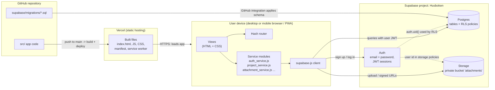

# Husboken

Husboken ("the house book") is a web app for keeping track of private home projects:
garden planning, gardening, renovation and building projects. Each user logs in
with a personal account and stores notes, measurements, drawings, photos and
contact details per project. The app works in desktop browsers and is designed
mobile-first so it can be used on site with a phone (including taking photos
directly with the camera).

The project is intentionally small: the goal is a working, deployed MVP within
roughly 5 hours. The developer's background is C/C++, so prefer plain, explicit
code over framework magic, and explain JavaScript-specific concepts (promises,
async/await, modules, closures) briefly in comments where they first appear.

## MVP scope

In scope:
1. Sign up, log in, log out (email + password). Users only ever see their own data.
2. Projects: name, type (`garden_planning`, `gardening`, `renovation`, `building`),
   status (`planned`, `in_progress`, `done`), description, created/updated dates.
3. Notes per project (free text).
4. Measurements per project (label, value, unit, optional comment).
5. Attachments per project: photos and drawings uploaded as image or PDF files,
   shown in a gallery.
6. Contacts per project (name, role, phone, email, comment).
7. Responsive, mobile-friendly UI, installable as a PWA (add to home screen).
8. Deployed to a public URL.

Out of scope for now: in-browser drawing tool, sharing projects between users,
full-text search, offline mode, native mobile apps.

## Tech stack

| Layer | Technology | Purpose |
|---|---|---|
| Language | JavaScript (ES2022, ES modules) | All application code. No TypeScript, to keep it simple. |
| Build tool / dev server | Vite | Fast local dev server with hot reload, production build to static files. |
| UI | Vanilla JavaScript + HTML templates | No UI framework; small, explicit view modules. |
| Styling | Plain CSS (CSS custom properties, flexbox/grid) | Mobile-first responsive layout. |
| Routing | Small hash-based router (`#/projects/42`) | Works on any static host without server config. |
| Backend-as-a-service | Supabase | Hosted backend, no server code of our own. |
| Authentication | Supabase Auth (email + password) | Personal login per user, session handling. |
| Database | Supabase Postgres + Row Level Security (RLS) | Stores projects, notes, measurements, contacts, attachment metadata. RLS enforces per-user access. |
| File storage | Supabase Storage (private bucket `attachments`) | Photos and drawings, stored under `<user_id>/<project_id>/<file>`. |
| Client library | `@supabase/supabase-js` | Talks to Auth, Database and Storage from the browser. |
| Database migrations | Supabase CLI, SQL files in `supabase/migrations/` | Schema is version controlled; applied via the Supabase GitHub integration. |
| PWA | Web app manifest + minimal service worker | "Add to home screen" on mobile. |
| Hosting | Vercel (connected to the GitHub repo) | Builds and deploys on every push to `main`, gives a public URL. |
| Source control | Git + GitHub | Repo is linked to both Supabase and Vercel. |
| Documentation | Doxygen-style comments | See code conventions. |

## Architecture

The app is a static single-page application. There is no custom backend server:
the browser talks directly to Supabase, and security is enforced in the database
by Row Level Security policies and in Storage by bucket policies. Because of this,
**all access control must live in SQL policies, never only in frontend code.**



### Request flow (example: open a project)

1. Browser loads static files from Vercel.
2. `auth_service` restores the Supabase session (JWT stored by supabase-js).
3. Router matches `#/projects/42` and calls the project view.
4. The view calls `project_service.get_project(42)`, which queries Postgres via supabase-js.
5. Postgres RLS checks `owner_id = auth.uid()` and returns only the user's own rows.
6. Attachments are listed from the `attachments` table; images are shown via short-lived
   signed URLs from Storage.

### Data model

All tables have `id bigint generated always as identity primary key`,
`created_at timestamptz default now()` and RLS enabled.

| Table | Key columns |
|---|---|
| `projects` | `owner_id uuid references auth.users`, `name`, `type`, `status`, `description`, `updated_at` |
| `notes` | `project_id references projects on delete cascade`, `owner_id`, `body` |
| `measurements` | `project_id`, `owner_id`, `label`, `value numeric`, `unit`, `comment` |
| `contacts` | `project_id`, `owner_id`, `name`, `role`, `phone`, `email`, `comment` |
| `attachments` | `project_id`, `owner_id`, `kind` (`photo` / `drawing`), `storage_path`, `file_name`, `mime_type`, `caption` |

RLS policy pattern for every table: select/insert/update/delete allowed only when
`owner_id = auth.uid()`. `owner_id` defaults to `auth.uid()`.

Storage policy: a user may read and write objects only where the first path
segment equals their user id (`(storage.foldername(name))[1] = auth.uid()::text`).

## Project structure

```
husboken/
├── CLAUDE.md
├── index.html
├── package.json
├── vite.config.js
├── .env.example            # VITE_SUPABASE_URL, VITE_SUPABASE_ANON_KEY
├── public/
│   ├── manifest.webmanifest
│   ├── service_worker.js
│   └── icons/
├── src/
│   ├── main.js             # entry point: init client, auth listener, router
│   ├── supabase_client.js  # creates the single supabase-js client
│   ├── router.js
│   ├── services/           # all Supabase calls live here, nowhere else
│   │   ├── auth_service.js
│   │   ├── project_service.js
│   │   ├── note_service.js
│   │   ├── measurement_service.js
│   │   ├── contact_service.js
│   │   └── attachment_service.js
│   ├── views/              # render functions per page
│   │   ├── login_view.js
│   │   ├── project_list_view.js
│   │   └── project_detail_view.js
│   ├── components/         # reusable UI pieces (forms, gallery, dialogs)
│   └── styles/
│       └── main.css
└── supabase/
    ├── config.toml
    └── migrations/
        └── <timestamp>_initial_schema.sql
```

## Commands

```bash
npm install          # install dependencies
npm run dev          # start local dev server (http://localhost:5173)
npm run build        # production build to dist/
npm run preview      # serve the production build locally

npx supabase login                    # once
npx supabase link --project-ref <ref> # once, links CLI to the Husboken project
npx supabase migration new <name>     # create a new migration file
npx supabase db push                  # apply migrations to the remote database
```

## Configuration and secrets

- Copy `.env.example` to `.env.local` and fill in `VITE_SUPABASE_URL` and
  `VITE_SUPABASE_ANON_KEY` (the public anon/publishable key) from the Supabase dashboard.
- The same two variables must be set in Vercel project settings.
- **Never** put the `service_role` key or database password in frontend code,
  `.env` files that are committed, or anywhere under `src/`. The anon key is safe to
  expose only because RLS is enabled on every table.
- `.env.local` is git-ignored.

## Code conventions

- **Naming**
  - `snake_case` for variables, functions, parameters, file names and database identifiers.
  - `PascalCase` for classes.
  - `UPPER_SNAKE_CASE` for module-level constants.
- **Documentation**: every function (including methods and arrow functions assigned
  to names) has a Doxygen-style comment block. Use `/** ... */` with `@brief`,
  `@param`, `@return` and, where relevant, `@throws`. Each file starts with a
  `@file` block describing its purpose.

  ```js
  /**
   * @file project_service.js
   * @brief Database access for projects.
   */

  /**
   * @brief Fetch all projects owned by the logged-in user.
   * @param sort_field Column to sort by, e.g. "updated_at".
   * @return Promise resolving to an array of project objects.
   * @throws Error if the Supabase query fails.
   */
  async function get_projects(sort_field = "updated_at") {
      const { data, error } = await supabase
          .from("projects")
          .select("*")
          .order(sort_field, { ascending: false });
      if (error) throw error;
      return data;
  }
  ```
- **Separation of concerns**: views never call Supabase directly; they call service
  functions. Services return plain data or throw errors; views handle display and
  user-facing error messages.
- **Error handling**: always check the `error` returned by supabase-js. Show a
  readable message to the user; never fail silently.
- **Security**: never build HTML from user input with `innerHTML`. Use
  `textContent` or create elements with `document.createElement` to avoid XSS.
- **Async**: use `async`/`await`, not `.then()` chains.
- **Style**: 4-space indentation, double quotes, semicolons, `const` by default and
  `let` only when reassigned, never `var`.
- **Database**: every schema change is a new migration file; never edit an applied
  migration. Every new table gets RLS enabled and owner policies in the same migration.
- **Language**: code, comments and commit messages in English. UI text in Swedish.

## Working agreements for Claude

- Keep changes small and runnable; after each feature the app should still build.
- Prefer the simplest solution that meets the MVP scope; ask before adding dependencies.
- When introducing a JavaScript concept that has no direct C/C++ equivalent, add a
  short explanatory comment.
- Test RLS by checking that a second user cannot see the first user's data.
